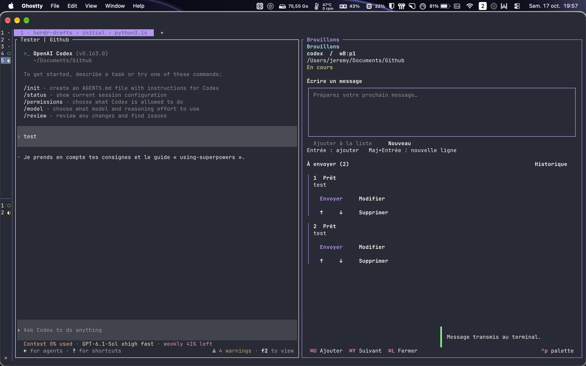

# Herdr Queue

Draft, queue, and send prompts to your AI coding agents from a dedicated terminal panel.

Write your next prompts while your agent is working. Keep them in a list, edit or reorder
them, then send the one you want. Open Queue beside an agent in [Herdr](https://herdr.dev),
or launch it in another terminal and choose an agent from a searchable list.



## Install in Herdr

You need **Herdr 0.9.3+**, **Python 3.11+**, and [uv](https://docs.astral.sh/uv/), on
**macOS or Linux**.

```sh
herdr plugin install Wormav/herdr-queue
```

Herdr downloads the repository and builds its Python environment. The internal plugin
ID is **`herdr-drafts`**; use that ID in Herdr commands and keybindings.

### Open it beside an agent

Add a shortcut to `~/.config/herdr/config.toml`. This example uses **Cmd+I** on macOS;
choose a key your terminal and Herdr do not already use.

```toml
[[keys.command]]
key = "cmd+i"
type = "plugin_action"
command = "herdr-drafts.open"
description = "Open Herdr Queue"
```

For a prefix shortcut instead, set `key = "prefix+i"`. With Herdr's default prefix,
press **Ctrl+B**, then **I**.

Validate and reload the configuration:

```sh
herdr config check
herdr server reload-config
```

Select your **agent's terminal** in Herdr, then press the shortcut. Queue opens to its
right, bound to that conversation. Selecting another terminal does not change the recipient.
Installing the plugin does not add this shortcut automatically.

If you already linked a local checkout, keep using it or run `herdr plugin unlink herdr-drafts`
before switching to the GitHub installation. Herdr will not install over a local link.

## Use it from another terminal

```sh
git clone https://github.com/Wormav/herdr-queue.git
cd herdr-queue
./run.sh
```

The launcher prepares its Python environment on the first run. Herdr must be running,
and its CLI must be available in your `PATH`.

Search for an agent by project, name, or type, then select it with a click or **Enter**.
Its queue opens in the terminal where you launched the app. Use **Agents** or **Cmd+O**
to switch agents; each conversation keeps its own drafts and unfinished text.
The picker refreshes every five seconds.

To select a particular local session or socket:

```sh
./run.sh --session default
./run.sh --socket /path/to/herdr.sock
```

Only one Queue window can own a given agent terminal at a time. Close its existing
Queue window before opening it elsewhere. The standalone app and Herdr panel share storage.

Try the interface without connecting to an agent:

```sh
./run.sh demo
```

The demo uses temporary drafts and simulates every send.

## Work with your queue

1. Write a prompt. **Enter** adds it to the list; **Shift+Enter** inserts a new line.
2. Prepare more prompts while your agent works. Edit, delete, or reorder them with the
   controls on each card.
3. Click **Envoyer** on a particular prompt, or press **Cmd+Y** to send the first one.
4. Open **Historique** to see transmitted messages and reuse their text.

The interface currently uses French labels. **Ajouter à la liste** means “Add to queue,”
**Envoyer** means “Send,” and **Historique** means “History.” It follows your terminal's
background, text colors, and ANSI palette.

### Keyboard shortcuts

| Action | macOS | Other keys |
| --- | --- | --- |
| Add a draft / save an edit | Enter or **Cmd+U** | Enter, Ctrl+S, or F2 |
| Insert a new line | Shift+Enter | Shift+Enter or Ctrl+J |
| Send the first queued prompt | **Cmd+Y** | Ctrl+T or F8 |
| Start a new draft | Cmd+P | Ctrl+N or F4 |
| Choose another agent (standalone) | Cmd+O | Ctrl+G or F3 |
| Refresh | Cmd+R | Ctrl+R or F5 |
| Close and keep drafts | Cmd+L | Ctrl+Q or F10 |

Cmd shortcuts require a terminal that forwards them through the Kitty keyboard protocol.
Terminal and Herdr shortcuts take precedence; the letters above avoid the bindings in
our Ghostty/Herdr development setup. On Mac keyboards, function keys may require **fn**.
Buttons are also accessible with **Tab** and **Shift+Tab**.

Sending the first prompt follows the queue's current order and keeps unfinished text in
the editor. It sends one prompt per activation. A prompt being edited, an unresolved send,
or an active transmission blocks this shortcut. It is inactive in history and confirmation dialogs.

## Sending and recovery

Sending is manual. Herdr Queue submits text through Herdr's `agent.prompt` API.
**Transmis au terminal** means Herdr confirmed submission to the terminal; it does not
mean the agent has processed the prompt. Your CLI decides whether a message received
during a run is queued or used to steer the current task. Check that behavior with your
versions of Codex, Claude Code, or Antigravity.

If an agent needs an interactive response or its status is unknown, sending is refused
and the draft is kept. Answer the agent in its terminal, then retry.

If a connection drops during submission, the draft becomes **Envoi à vérifier** (“Check
delivery”). Inspect the agent's terminal, then mark it **Déjà transmis** (“Already sent”)
or **Remettre en brouillon** (“Return to drafts”). Returning it to drafts does not send it.
There is no automatic retry or queue draining.

Drafts stay tied to the selected agent and conversation. If the conversation is replaced,
close Queue and reopen it for the new conversation. The old drafts remain stored separately.

## Local storage

Drafts and unfinished text are saved in a local SQLite database at:

```text
$XDG_STATE_HOME/herdr/plugins/herdr-drafts/drafts.sqlite3
```

The default is `~/.local/state/herdr/plugins/herdr-drafts/drafts.sqlite3`.
`HERDR_PLUGIN_STATE_DIR` overrides the directory when supplied by Herdr.
Close Queue before copying the database, or use SQLite's backup API to include active WAL data.

Herdr Queue does not call a model, start an HTTP server, or interpret prompts as shell commands.
Each prompt is limited to **64 KiB of UTF-8 text**. Terminal control characters are rejected,
except for new lines and tabs.

For a local version and storage diagnostic, run `./run.sh doctor` from a checkout.

## Development

```sh
git clone https://github.com/Wormav/herdr-queue.git
cd herdr-queue
uv sync --frozen
uv run pytest -q
uv run ruff check src tests
uv run ruff format --check src tests
uv run mypy src/herdr_drafts
uv build
```

Link a checkout to Herdr with `herdr plugin link "$PWD"`. After changing the code,
close and reopen Queue to load it.

Tests cover persistence, agent identity changes, duplicate sends, connection failures,
uncertain delivery, agent discovery, keyboard shortcuts, and the Textual interface.
They use a fake Herdr server over Unix `socketpair` streams and do not contact your agents.
The [manual test checklist](docs/TESTING.md) is available in French.

## Uninstall

```sh
herdr plugin uninstall herdr-drafts
```

For a linked checkout, use `herdr plugin unlink herdr-drafts` instead.
Local drafts and your Herdr keybinding configuration are kept.

## License

[MIT](LICENSE).
