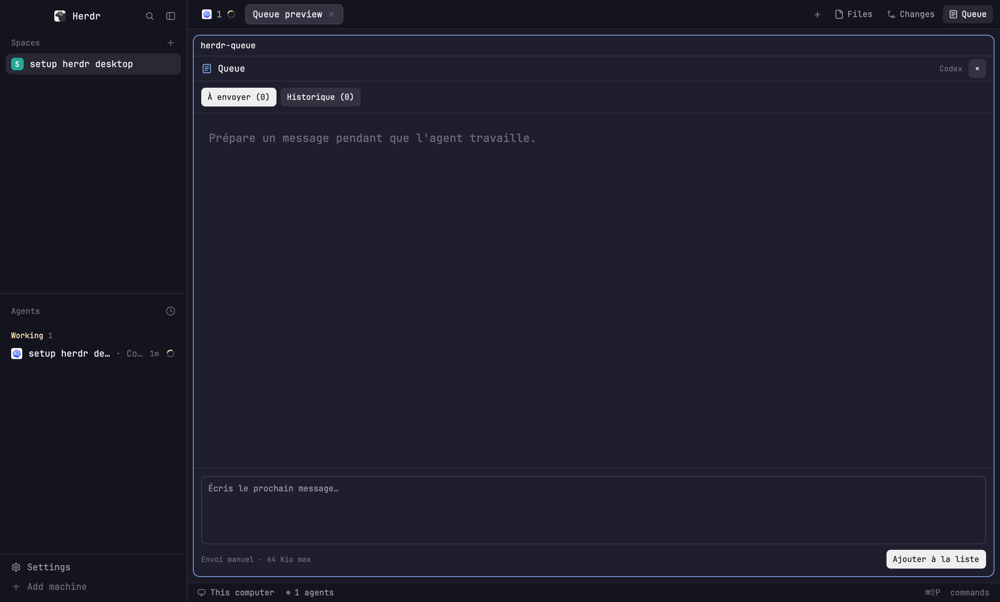

# Herdr Queue

Prepare messages while an agent works. The usual Herdr window gains a **Queue** button after **Files** and **Changes**; it opens a draft list beside the agent in the active tab. Add, edit, reorder and send individual messages manually, with a separate queue and history for each terminal.

## What you see

The layout keeps Herdr's familiar dark window: a 268 px spaces and agents sidebar, a 42 px tab bar, the active tab's panes, and a 28 px status bar. The tab bar has the normal **Files** and **Changes** controls followed by a list icon and **Queue**. The button is highlighted while its pane is open.

Queue opens to the right of the selected agent. Its 36 px header names the queue and the agent. **À envoyer** and **Historique** switch between pending drafts and sent messages. Draft cards show a text preview, **Envoyer**, **Modifier**, up/down controls and **Supprimer**. The composer stays at the bottom with **Ajouter à la liste**; an empty queue shows a short prompt instead of cards. Colors follow Herdr's current theme.

## How it behaves

- Click **Queue** or press **Cmd+I** to open or close the pane. It binds to an agent in the active tab and stays with that terminal even if focus changes. With no agent in the tab, it shows a notice instead of opening an empty queue.
- Type a prompt and press Enter or click **Ajouter à la liste**. Shift+Enter inserts a line break. Editing a draft preserves unfinished text in the composer.
- Move drafts with the arrow buttons. Click **Envoyer** on one draft to submit only that draft through `hc send`; nothing is sent automatically. The sent item moves to **Historique**, where its text can be reused.
- A known refusal leaves the draft in the queue with an error. An unconfirmed submission becomes an uncertain item with **Déjà transmis** and **Remettre en brouillon** controls. Check the agent's terminal before choosing either one.
- The shipped tab and agent indicators remain: working agents show a spinner, blocked and done agents show status dots. Queue refuses to send to a blocked or missing agent; other statuses do not trigger sending.

## Built from

`layouts/main-queue.json` follows Herdr's main layout. Its `tabs` block loads `mods/tabs-queue` while its sidebar, pane header, status bar, Files and Changes blocks continue to use Herdr's shipped mods. The Files/Changes side panel remains separate from the Queue pane.

`mods/tabs-queue` is a copy of Herdr's tab bar with the Queue button. It reads `spaces()`, `panes()`, `agents()` and `focused()` to find the active agent, then calls `pane.split` with `mod: "herdr-queue"` and the agent terminal and tab in `props`. A second click calls `pane.close`. It also handles the `tabs-queue.open_queue` command for the optional `keys.json` binding.

`mods/herdr-queue` renders the composer, draft cards and history with `gpui-kit` and `gpui-base`. It saves per-terminal data under `herdr-queue.desktop` using `shared()` and `setShared()`. It runs the local `hc` executable through `exec()` to send a selected message, and uses `notify()` after confirmed submission. The SVG list icon is in that mod's folder. `keys.json` provides the optional `layout:main-queue` Cmd+I binding.

## Watch out

- This is a **layout** package because the button replaces Herdr's shipped tab bar. Copy both mod folders and the layout; installing only the Queue mod will not add the button. Merge the key snippet instead of replacing a person's `keys.json`.
- The Desktop app needs a working local `hc` command and an agent in the active tab. The mod executes `hc`; it does not contact a web service itself. Agent commands determine how a message received during a run is handled.
- Desktop uses Herdr's shared state, keyed by Core terminal address. Existing TUI drafts are in a separate SQLite database and are not migrated automatically. A different terminal starts with a different queue.
- Each message is limited to 64 KiB of UTF-8; control characters other than tabs and newlines are rejected. A lost send acknowledgment must be resolved manually to avoid accidental duplicates.
- The tab bar was copied from Herdr Desktop 0.1.15. Reconcile it with newer shipped tab bars when upgrading the app. The interface labels are currently French.

## Done when

- `herdr-app check mods/tabs-queue` and `herdr-app check mods/herdr-queue` pass, and switching to `main-queue` shows **Queue** after **Changes**.
- On a tab with an agent, clicking **Queue** opens a pane on its right; clicking again closes it. Cmd+I does the same after merging `keys.json`.
- Enter creates one draft; Shift+Enter leaves a line break in the composer. Editing, moving and deleting a draft update the queue, and reopening the pane restores its contents.
- Clicking **Envoyer** on a disposable prompt sends only that prompt to the chosen terminal and moves it to history. A refused or unconfirmed send keeps the text available for recovery.
